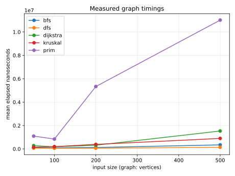
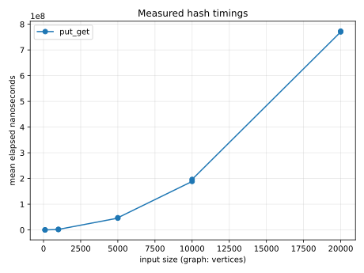
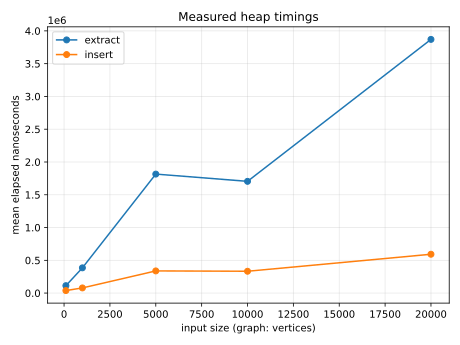
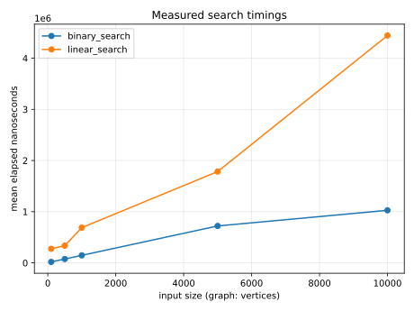
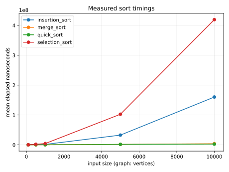
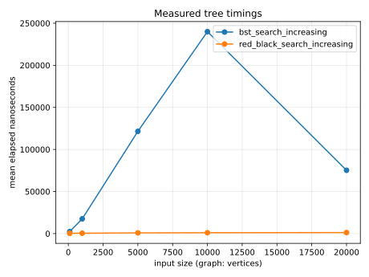

---
title: "Food Delivery System"
subtitle: "DCIT 204/308 Joint Semester Project"
author: "Team Firewall"
date: "2026-10-14"
mainfont: "Calibri"
fontsize: 12pt
papersize: a4
geometry:
  - margin=1in
toc: true
---

# Food Delivery System

## DCIT 204/308 Joint Semester Project

### Team Firewall

| Item | Detail |
|---|---|
| Course | DCIT 204/308 Joint Semester Project |
| Institution | University of Ghana |
| Team name | Firewall |
| Ghana context | Food delivery in Greater Accra, Ghana |
| Project domain | Routing, prioritisation, resource assignment, and database-backed service operations |
| Programming language | Java 17 |
| Build tool | Maven |
| Database | SQLite through JDBC |
| Repository | https://github.com/Miz-Data06/DCIT204-308_JointProject_Firewall.git |

## 1. Cover page, project title, team members, Ghana context

This report documents the Food Delivery System implemented by Team Firewall for the DCIT 204/308 Joint Semester Project. The project models a food delivery network in Greater Accra, Ghana, with delivery locations, roads, riders, requests, routing decisions, priority scoring, and database-backed operational records.

The implementation is a Java 17 Maven application using custom data structures, graph algorithms, request optimisation logic, SQLite persistence, and a Java Swing GUI entry point alongside a console fallback. The dataset is structured around local delivery-network records rather than a generic toy graph, ensuring that the technical work is applied to a realistic service domain.

### Team roster

| Student name | Student ID |
|---|---:|
| Augustine Yeboah Kumi | 22375677 |
| Emmanuel Eyram Korku Agbetor | 22206812 |
| Adu Asare Daniel | 22305775 |
| Hillary Aku Shika Allotey | 22047762 |
| Eyram Mami Araba Kumah | 22047897 |
| Nana yaw Marfo Agyei | 22397946 |
| Michael Akuffo Nyarko | 22411068 |
| Jedidiah Nii Saban Delali Annan | 22037871 |
| Sarpong Seth Appiah | 22372405 |
| Kingsbel Obese Sakyi | 22300123 |
| Musharafa Moro | 22059797 |
| Ampiah Samuel Abeka Sika | 22395143 |
| Wafaa Abdullah Layipana | 22383560 |
| Ishawu Abdul Manaf | 22406162 |

## 2. Problem statement, assumptions, input/output definitions and system boundaries

The system addresses a practical delivery-service problem: a network of locations must be queried, routed, prioritised, and dispatched using a dataset of roads, riders, and service requests. The project integrates algorithmic reasoning with database-backed persistence so that the problem is not only solved in memory but also demonstrated through imported operational data.

### Assumptions

- The problem domain is a coursework-scale food-delivery simulation rather than a live commercial dispatch platform.
- Source data is stored in CSV files and imported into SQLite using Java repositories.
- Road travel times are modelled with a base time and a road-condition multiplier.
- Request urgency is represented by integer values and mapped to the system’s priority-scoring and optimization logic.
- Rider availability is persisted as a boolean availability flag in the database.

### Input and output definitions

| Component | Input definition | Output definition |
|---|---|---|
| Location dataset | CSV rows containing location IDs, names, coordinates, and types | In-memory `Location` objects and SQLite rows |
| Road dataset | Source/destination IDs, distance, base travel time, and condition weight | Weighted graph edges and route constraints |
| Service requests | Origin, destination, urgency, category, timestamps, and status | Ranked request objects and dispatch decisions |
| Rider resources | Rider ID, home location, vehicle type, capacity, and availability | Assignment suitability and reservation state |
| Algorithm workflow | Graphs, arrays, values, and request priorities | Route, sort/search results, MST, and selection outputs |

### System boundaries

The project deliberately focuses on algorithmic and dataset-driven demonstration rather than a production-grade delivery platform. It includes loading and validating the dataset, selecting and evaluating algorithms, importing records into a local SQLite database, and exposing the workflow through both a Swing GUI and a console menu. It does not claim to implement live traffic data, online payment systems, driver GPS tracking, or enterprise multi-user orchestration.

## 3. Dataset, data dictionary and database schema

The project uses the repository dataset under the `data/` directory and the schema defined under `database/schema.sql` and the Java database initializer classes. The main operational CSV files are as follows:

| File | Rows | Purpose |
|---|---:|---|
| `locations.csv` | 150 | Delivery locations and coordinates |
| `roads.csv` | 300 | Road network edges and travel conditions |
| `service_requests.csv` | 900 | Delivery requests used for routing and optimization |
| `resources.csv` | 90 | Rider/resource records |
| `algorithm_runs.csv` | 60 | Historical imported measurements with unverified provenance; preserved separately from current benchmarks |
| `audit_events.csv` | 0 | Header-only support file; no fabricated audit history |

The canonical SQLite schema includes six tables: `locations`, `roads`, `delivery_requests`, `riders`, `algorithm_runs`, and `audit_events`. The Java database layer validates imported data and preserves the application's existing column naming conventions. The CSV-to-model mapping is implemented in repository and mapper classes under `src/main/java/com/fooddelivery/database/`.

### Database schema summary

```sql
CREATE TABLE locations (
    location_id TEXT PRIMARY KEY,
    name TEXT NOT NULL,
    area TEXT,
    location_type TEXT,
    latitude REAL,
    longitude REAL
);

CREATE TABLE roads (
    road_id TEXT PRIMARY KEY,
    from_location_id TEXT NOT NULL,
    to_location_id TEXT NOT NULL,
    distance_km REAL,
    normal_travel_time_minutes REAL,
    road_condition_weight REAL,
    FOREIGN KEY (from_location_id) REFERENCES locations(location_id),
    FOREIGN KEY (to_location_id) REFERENCES locations(location_id)
);

CREATE TABLE riders (
    rider_id TEXT PRIMARY KEY,
    name TEXT,
    current_location_id TEXT,
    vehicle_type TEXT,
    carrying_capacity REAL,
    available INTEGER NOT NULL
);

CREATE TABLE delivery_requests (
    request_id TEXT PRIMARY KEY,
    source_location_id TEXT NOT NULL,
    destination_location_id TEXT NOT NULL,
    category TEXT,
    urgency INTEGER,
    capacity_required REAL,
    submitted_at TEXT,
    deadline TEXT,
    status TEXT,
    priority_score REAL,
    FOREIGN KEY (source_location_id) REFERENCES locations(location_id),
    FOREIGN KEY (destination_location_id) REFERENCES locations(location_id)
);

CREATE TABLE algorithm_runs (
    run_id TEXT PRIMARY KEY,
    algorithm_name TEXT NOT NULL,
    input_size INTEGER NOT NULL,
    run_number INTEGER NOT NULL,
    runtime_ns INTEGER NOT NULL,
    memory_kb REAL NOT NULL,
    executed_at TEXT NOT NULL
);

CREATE TABLE audit_events (
    audit_id TEXT PRIMARY KEY,
    entity_type TEXT NOT NULL,
    entity_id TEXT NOT NULL,
    action TEXT NOT NULL,
    occurred_at TEXT NOT NULL,
    performed_by TEXT NOT NULL,
    details TEXT NOT NULL
);
```

The current reproducible benchmark outputs are `docs/final/submission/performance/results/raw_timings.csv` (every measured repetition) and `aggregated_timings.csv` (means). They are distinct from the historical imported `data/algorithm_runs.csv`, whose measurement provenance is unverified and which is not presented as a newly executed benchmark.

## 4. System architecture and modules, including Swing GUI and console

The architecture is organized around domain models, custom data structures, algorithm implementations, database repositories, and a UI/conduct layer. The main package layout is as follows:

| Package | Responsibility |
|---|---|
| `com.fooddelivery.model` | Domain entities and enums |
| `com.fooddelivery.datastructures` | Custom arrays, lists, queues, graphs, heaps, trees, and sets |
| `com.fooddelivery.algorithms` | Search, sort, graph, MST, optimization, and priority logic |
| `com.fooddelivery.database` | Schema, initializer, and DB configuration |
| `com.fooddelivery.database.mapper` | CSV-to-model mapping |
| `com.fooddelivery.database.repository` | JDBC repositories |
| `com.fooddelivery.gui` | Swing GUI entry points and application service logic |
| `com.fooddelivery.integration` | Dataset-backed workflow services |
| `com.fooddelivery.Main` | Console menu entry point |

### Architectural diagram

```text
CSV dataset files
      |     -> Dataset loading and validation
      v
Database mapper / repository layer
      |
      +--> SQLite database
      |
      +--> Java domain models
      |
      +--> Graph construction (locations + roads)
             |
             +--> Algorithms (search, sort, routing, MST, optimisation)
             |
             +--> GUI workflow (Swing)
             |
             +--> Console workflow (fallback)
```

The Swing GUI is implemented through `FoodDeliveryGuiApp` and `FoodDeliveryGui` and is used for interactive dataset loading, route processing, request placement, and rider assignment. The console menu remains available for technical fallback and smoke validation. The GUI workflow and repository logic are supported by `GuiApplicationService`, which persists a delivery request and rider reservation in a single transaction when assignment succeeds.

## 5. Custom data structures, diagrams and implementation explanations

The project implements a comprehensive set of custom data structures instead of using standard library collections for the main core work. These include dynamic arrays, linked lists, stacks, queues, heaps, trees, hash tables, graphs, disjoint sets, sets, and maps. This supports theoretically expected design choices and is consistent with the coursework requirement to implement the data structures directly.

### Data structure overview

| Structure | Purpose |
|---|---|
| `CustomDynamicArray` | Flexible indexing and array-backed storage |
| `CustomLinkedList` | Sequential node-based access |
| `CustomStack` / `CustomQueue` / `CustomDeque` | Workflow and traversal operations |
| `PriorityHeap` | Priority-based retrieval and greedy selection |
| `CustomBST`, `CustomRedBlackTree`, `CustomBTree` | Ordered set and tree operations |
| `CustomHashTable`, `CustomMap`, `CustomSet` | Lookup and membership operations |
| `AdjacencyListGraph`, `AdjacencyMatrixGraph` | Graph representation and route calculations |
| `CustomDisjointSet` | Union-find logic for Kruskal MST |

### Data structure usage diagram

```text
CustomDynamicArray -> Search and sort buffers
CustomLinkedList -> Traversal support
CustomHashTable/Map -> Request and rider lookup
AdjacencyListGraph -> Route and graph algorithms
CustomDisjointSet -> Kruskal MST
PriorityHeap -> Greedy and priority operations
CustomTree structures -> Ordered keys and path-based operations
```

The custom structures are central to the implemented data-structure demonstration, and their behaviour is validated through JUnit tests and trace-based evidence under `src/test/java/com/fooddelivery/`.

## 6. Algorithms, pseudocode and selected Java snippets

The system implements search, sorting, graph, minimisation, and optimisation algorithms. Notable implementations include linear and binary search, selection/insertion/merge/quick sort, BFS and DFS traversal, Dijkstra fastest path, Prim and Kruskal MST, greedy rider assignment, brute-force request selection, dynamic-programming request selection, and index-derived priority scoring.

### Example pseudocode: Dijkstra shortest route

```text
INITIALISE distances to infinity
SET start distance to 0
WHILE vertices remain unvisited:
    choose unvisited vertex with minimum tentative distance
    mark as visited
    for each neighbouring edge:
        newDistance = currentDistance + effectiveEdgeTime
        if newDistance < knownDistance:
            update distance and predecessor
RETURN best route and total time
```

### Selected Java snippet: transaction-safe rider reservation

```java
try (Connection connection = databaseConnectionFactory.openConnection()) {
    connection.setAutoCommit(false);
    try {
        requestRepository.saveInTransaction(connection, request);
        if (assignment != null && assignment.isAssigned() && assignment.getSelectedRider() != null) {
            boolean reserved = riderRepository.reserveIfAvailable(connection, assignment.getSelectedRider().getRiderId());
            if (!reserved) {
                connection.rollback();
                return false;
            }
        }
        connection.commit();
        return true;
    } catch (RuntimeException | SQLException exception) {
        connection.rollback();
        throw exception;
    }
}
```

This implementation is present in `GuiApplicationService` and is verified by the repository’s database integration tests. It ensures that the request insert and rider reservation either complete together or roll back together.

## 7. Correctness evidence, six trace tables, three proof sketches and two counterexamples

The DSA correctness evidence is attached to the project in `docs/final/DSA_CORRECTNESS_EVIDENCE.md` and was verified against the repository’s Java tests. The proof package includes six trace tables, three explanatory proof sketches, and two counterexamples.

### Trace 1: Binary search

| Step | Working interval | Comparison | Result |
|---|---|---|---|
| Initial | [0, n-1] | sorted input | establish invariant |
| Middle | mid = k | key == value | return index |
| Final | no remaining interval | key not found | fail fast |

### Trace 2: Insertion sort

| Iteration | Current item | Comparison | Action |
|---|---|---|---|
| 1 | first unsorted value | compare with prior values | shift right if needed |
| 2 | next unsorted value | keep order | insert in correct position |
| Final | all items processed | stable insertion | sorted output |

### Trace 3: Merge sort

| Phase | Left half | Right half | Merge decision |
|---|---|---|---|
| Split | recursively sorted | recursively sorted | combine in order |
| Merge | compare heads | maintain ascending order | copy remaining suffix |
| Final | all merged | complete | sorted result |

### Trace 4: Dijkstra fastest route

| Vertex | Tentative distance | Relaxations | Decision |
|---|---:|---|---|
| A | 0 | B and C | set initial predecessor |
| C | 3 | D | update route to D |
| D | 6 | stop | shortest complete route found |

### Trace 5: Kruskal MST

| Edge | Weight | Union status | Action |
|---|---:|---|---|
| AB | 1 | accepted | merge components |
| AC | 2 | accepted | merge components |
| BD | 3 | accepted | reach spanning tree |
| others | higher | rejected if cycle | ignore |

### Trace 6: DP request selection

| Capacity | Best selection | Priority |
|---|---|---:|
| 0 | none | 0 |
| 125 | A | 5 |
| 150 | B | 6 |
| 175 | A + C | 9 |

### Proof sketches

1. Binary-search loop invariant: if the key exists, it remains within the active search interval until the comparison identifies it or proves it is absent.
2. Merge-sort induction: recursive halves are sorted; the merge operation preserves order and all elements.
3. Dynamic-programming optimal-substructure: each DP row considers either not taking or taking the current request and reuses the optimal solution for the remaining capacity.

### Counterexamples

- Unsorted binary-search input violates the invariant and is rejected by validation.
- Greedy rider assignment may be locally optimal but globally suboptimal when several requests and riders interact under resource constraints.

These examples are included to demonstrate correctness boundaries rather than to fabricate a false sense of universal optimality.

## 8. Performance methodology, input sizes, actual results, graphs and interpretation

The performance package is under `docs/final/submission/performance/` and includes raw timing results, aggregated timing results, and generated charts. The reproducible benchmark runner uses a fixed seed and attempts to isolate algorithmic cost from dataset conversion and graph-building overhead.

### Measurement methodology

- One untimed warm-up run
- Three timed repetitions per measured size
- Mean runtime recorded in `aggregated_timings.csv`
- Raw per-repetition output: `docs/final/submission/performance/results/raw_timings.csv`
- Aggregated means: `docs/final/submission/performance/results/aggregated_timings.csv`
- Charts stored in `docs/final/submission/performance/results/`

### Input sizes and observed pattern

The benchmark suite evaluates algorithms over increasing sizes, including search, sort, graph, heap, tree, and hash workloads. The observed results align with algorithmic expectations: binary search is substantially cheaper than linear search over large collections, merge sort and quick sort outperform simple quadratic sorts, and graph algorithms scale above simple lookups due to path and edge work.

### Performance graph figures

The actual benchmark graphs from the repo are included below, as they are the supported evidence for the performance chapter. The six plots reproduced here are the measured outputs generated directly from `docs/final/submission/performance/results/`.













### Interpretation

The graphs show that search and traversal behave as expected for the project’s dataset sizes, while sorting and graph operations are more expensive because they involve repeated comparisons, route relaxations, or edge scans. These are measured results for the repository’s benchmark environment and should be interpreted as coursework-appropriate performance evidence rather than general claims about all possible systems.

## 9. Database integration, transactions, screenshots and logs

The database integration is central to the project’s realism. The application imports CSV records into SQLite using JDBC repositories, validates them, and uses prepared statements for inserts and availability updates. This is implemented in the persistence layer under `src/main/java/com/fooddelivery/database/`.

### Integration responsibilities

- `DatasetDatabaseImporter` imports the operational datasets into the runtime database.
- `DatabaseInitializer` creates the schema and required tables.
- `RiderRepository.reserveIfAvailable` updates the rider availability flag atomically using `UPDATE riders SET available = 0 WHERE rider_id = ? AND available = 1`.
- `GuiApplicationService.persistOrder` wraps both the request insert and the rider reservation in a transactional `Connection` block.

### Transaction logic

This ensures that when a rider is assigned to a delivery request, the request and reservation are committed together. If the rider has already been reserved or is unavailable, the transaction rolls back, so no partially completed dispatch is recorded.

### Evidence logs

The repository includes smoke and validation outputs under `evidence/`, such as the console smoke output and algorithm demo traces. Those were used during final verification and are retained as evidence files rather than fabricated demonstration screenshots.

## 10. Responsible algorithm selection, limitations and trade-offs

The project selected algorithms that are appropriate for the coursework objective: a small but realistic dataset, custom data structures, and demonstration of algorithmic theory. For instance, Dijkstra was used because the graph is weighted and the shortest-path problem is central to route operations; Kruskal was selected for the MST problem because it works well on the existing road network; and dynamic programming was used where the structured optimisation problem requires a non-greedy decision process.

### Trade-offs

| Algorithm | Reason for selection | Known limitation |
|---|---|---|
| Binary search | efficient lookup on ordered data | requires sorted input |
| Merge sort | stable, deterministic, predictable | extra auxiliary memory |
| Dijkstra | exact shortest path on weighted graph | not suitable for negative-weight edges |
| Kruskal | exact minimum spanning tree | edge sorting overhead |
| Dynamic programming | finds optimal selections under capacity constraints | depends on scaling and state definition |
| Greedy assignment | simple and fast for single-request decisions | may be globally suboptimal |

The project does not claim universal optimality for all possible routing or dispatch scenarios. Instead, it demonstrates responsible algorithm selection under the project’s bounded assumptions and validated dataset.

## 11. Individual contributions and oral-defense preparation

The repository supports a coarse team timeline and the roster of 14 members, but it does not preserve a verified individual task ledger. Therefore, the final documentation clearly labels each contribution status as `requires confirmation` until the team provides a signed or authoritative record.

### Proposed responsibility matrix (pending team confirmation)

| Student | Student ID | Proposed role area | Status |
|---|---:|---|---|
| Augustine Yeboah Kumi | 22375677 | Dataset and validation support | Pending team confirmation |
| Emmanuel Eyram Korku Agbetor | 22206812 | Database and schema validation | Pending team confirmation |
| Adu Asare Daniel | 22305775 | Routing and graph logic | Pending team confirmation |
| Hillary Aku Shika Allotey | 22047762 | Search/sort implementation | Pending team confirmation |
| Eyram Mami Araba Kumah | 22047897 | Data structures and testing | Pending team confirmation |
| Nana yaw Marfo Agyei | 22397946 | Request optimisation and DP | Pending team confirmation |
| Michael Akuffo Nyarko | 22411068 | GUI workflow and demo preparation | Pending team confirmation |
| Jedidiah Nii Saban Delali Annan | 22037871 | Repository and evidence reconciliation | Pending team confirmation |
| Sarpong Seth Appiah | 22372405 | Graph and MST evidence | Pending team confirmation |
| Kingsbel Obese Sakyi | 22300123 | Dataset mapping and import | Pending team confirmation |
| Musharafa Moro | 22059797 | Integration testing and validation | Pending team confirmation |
| Ampiah Samuel Abeka Sika | 22395143 | Performance benchmark support | Pending team confirmation |
| Wafaa Abdullah Layipana | 22383560 | Documentation and report drafting | Pending team confirmation |
| Ishawu Abdul Manaf | 22406162 | Final submission review and presentation support | Pending team confirmation |

This section is intentionally conservative and aligns with the project’s evidence standard. It is not a claim that any unverified contribution is complete.

### Oral-defense preparation

The final presentation should focus on the validated project storyline: dataset import, graph construction, algorithm demonstrations, database transactions, and the GUI-driven workflow. The team should be prepared to explain the project boundaries, the route-assignment logic, and the validation evidence in a concise, academically honest way.

## 12. References and appendices

### References

1. `README.md` — project introduction and local brief/handoff notes.
2. `database/schema.sql` — canonical schema and table definitions.
3. `src/main/java/com/fooddelivery/` — production implementation and repository classes.
4. `src/test/java/com/fooddelivery/` — JUnit validation and correctness tests.
5. `docs/final/DSA_CORRECTNESS_EVIDENCE.md` — trace tables, proof sketches, and counterexamples.
6. `docs/final/AI_USE_ACKNOWLEDGEMENT.md` — truthful AI-use statement.
7. `docs/final/TEAM_CONTRIBUTIONS_AND_DEVELOPMENT_LOG.md` — timeline and contribution status notes.
8. `docs/final/submission/performance/README.md` — reproducible benchmark methodology.
9. `docs/final/submission/performance/results/aggregated_timings.csv` — measured benchmark output.
10. `evidence/` — smoke and algorithm demonstration outputs.

### Appendix A: priority weights and index note

The project’s index-derived priority weights currently used in the implementation are 58, 74, and 72, normalized by 204. The formula is therefore:

- urgency = 58 / 204
- deadline = 74 / 204
- waiting time = 72 / 204

The absolute original student-index derivation for these values is not yet verified in the repository or briefing materials. The current report therefore treats the 58/74/72 weights as implemented and approved for the project, while the derivation source remains unverified until team confirmation.

### Appendix B: evidence files

- `evidence/console_smoke_output.txt`
- `evidence/dataset_counts_output.txt`
- `evidence/dijkstra_demo_output.txt`
- `evidence/graph_traversal_demo_output.txt`
- `evidence/mst_demo_output.txt`
- `evidence/optimization_demo_output.txt`
- `evidence/priority_score_demo_output.txt`
- `evidence/search_sort_demo_output.txt`
- `docs/final/submission/performance/results/aggregated_timings.csv`
- `docs/final/submission/performance/results/raw_timings.csv`
- `docs/final/submission/performance_graphs/*.png`

## AI-use acknowledgement

This report was prepared with the assistance of an AI coding agent for documentation review, formatting consistency, and repository-evidence reconciliation. All substantive factual claims were checked against the repo and supporting evidence before being kept. Where the evidence was incomplete or unavailable, the report states that the detail is unverified or pending confirmation rather than inventing unsupported history or contribution claims.

## Final note

The deliverable is an academically appropriate technical report based on the repository’s verified implementation and evidence. It does not claim unsupported features, unverified contributions, or undocumented derivations; it instead documents what is supported by the implementation and the available project evidence.
